# eSim 2.5 on Ubuntu 25.04: report of fixes & verification

Ashutosh Parashar ([@asitos](https://github.com/asitos)) <br>
Screening Task 4 · FOSSEE Semester-Long Internship, Winter 2026

---

<p align="center">
  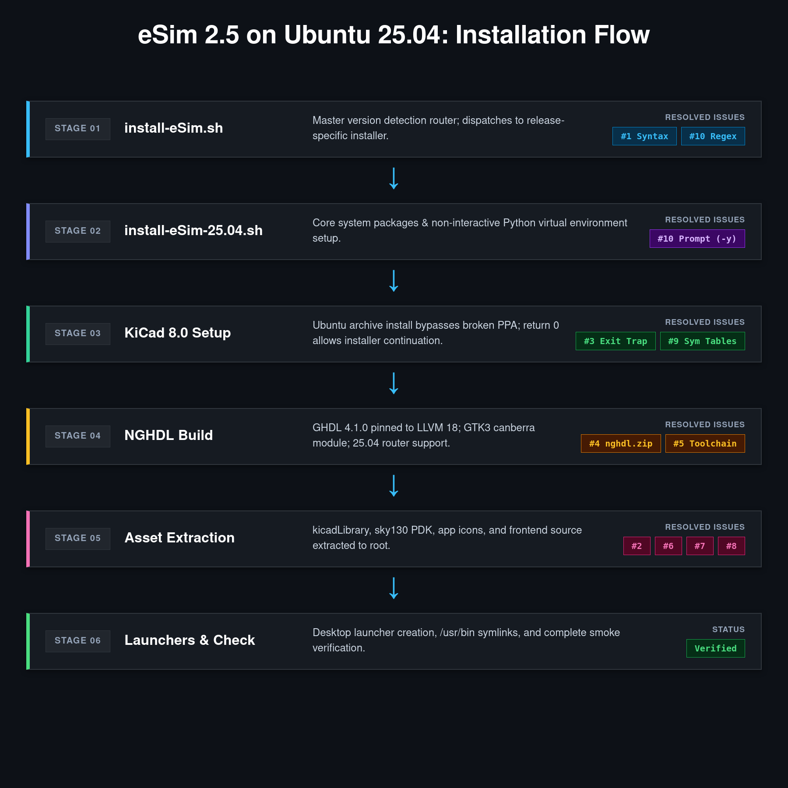
</p>

## test environments

<b>target test environment:</b>Ubuntu 25.04 (Plucky Puffin) VM on QEMU/KVM
<p align="center">
  
</p>

<b>development workstation:</b> Arch Linux (Kernel 6.17 / CachyOS)
<p align="center">
  
</p>

<b>tools used:</b>
- neovim for inspecting and editing shell scripts, makefiles, and source files
- bash, grep, find, and git (`git log -S`, `git blame`) to trace regression roots
- QEMU/KVM for isolated VM verification on clean Ubuntu 25.04 snapshots
- LLM coding agent for verifying and cross-checking edge cases, and documenting errors.

---

## architecture overview:

a key requirement of task 4 was delivering fixes on the `installers` branch. running `./Ubuntu/install-eSim.sh --install` on upstream `installers` failed immediately:

```
./Ubuntu/install-eSim.sh: line 70: syntax error near unexpected token `}'
./Ubuntu/install-eSim.sh: line 70: `}'
```

past this syntax error, the installer failed repeatedly because shared release assets were missing from the repository root.

<p align="center">
  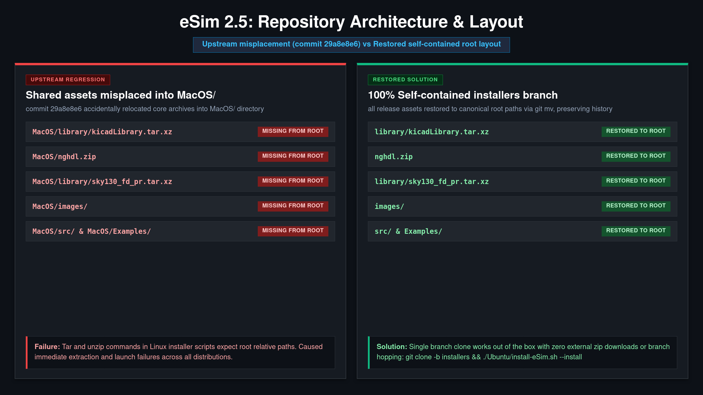
</p>

### the upstream asset relocation issue

initial investigation of missing archives on the upstream `installers` branch revealed an architectural regression rather than permanently missing assets.

running `git log --diff-filter=A --summary` on the missing archives uncovered the root cause: commit `29a8e8e6` ("Added macos support installing folder") had accidentally moved all shared release assets into `MacOS/`:
- `library/kicadLibrary.tar.xz` moved to `MacOS/library/`
- `nghdl.zip` moved to `MacOS/`
- `library/sky130_fd_pr.tar.xz` moved to `MacOS/library/`
- `images/` moved to `MacOS/images/`
- `src/`, `Examples/`, and component libraries moved into `MacOS/`

some linux installer scripts (Ubuntu, Fedora) expects these paths at the repository root. we restored all assets to their canonical root locations using `git mv`, preserving Git history.

**result:** the `installers` branch on this fork is 100% self-contained. Anyone can clone `https://github.com/asitos/eSim -b installers` and run `./Ubuntu/install-eSim.sh --install` on Ubuntu 25.04 without downloading external files.

## summary of fixes

| # | Problem | Proof | Fix | Commit |
|---|---|---|---|---|
| 1 | bash syntax error in `run_version_script` at line 70 | [screenshot](Ubuntu/screenshots/01_syntax_error.webp) | closed dangling `if`, purged 7 orphaned merge lines | [`d19714a1`](https://github.com/asitos/eSim/commit/d19714a1) |
| 2 | `kicadLibrary.tar.xz` not found at repo root | [screenshot](Ubuntu/screenshots/02_missing_kicadlibrary.webp) | restored from `MacOS/library/` via `git mv` | [`58b7a219`](https://github.com/asitos/eSim/commit/58b7a219) |
| 3 | silent exit when KiCad 8 is already installed | [screenshot](Ubuntu/screenshots/03_premature_exit.webp) | replaced `exit 0` with `return 0` in `installKicad()` | [`fc2248c5`](https://github.com/asitos/eSim/commit/fc2248c5) |
| 4 | `nghdl.zip` missing during NGHDL compilation step | [screenshot](Ubuntu/screenshots/04_missing_nghdl_zip.webp) | restored `nghdl.zip` from `MacOS/` via `git mv` | [`d088fc94`](https://github.com/asitos/eSim/commit/d088fc94) |
| 5 | unsupported OS 25.04, GTK2 EOL, GHDL LLVM mismatch | [screenshot](Ubuntu/screenshots/05_nghdl_unsupported_version.webp) | added 25.04 router, migrated to GTK3, pinned LLVM 18 | [`2dff020a`](https://github.com/asitos/eSim/commit/2dff020a) |
| 6 | `sky130_fd_pr.tar.xz` missing at repo root | [screenshot](Ubuntu/screenshots/06_missing_sky130_tarball.webp) | restored from `MacOS/library/` via `git mv` | [`c9a4fedc`](https://github.com/asitos/eSim/commit/c9a4fedc) |
| 7 | desktop launcher fails: `images/logo.png` missing | [screenshot](Ubuntu/screenshots/07_missing_logo_png.webp) | restored `images/` directory via `git mv` | [`280df64b`](https://github.com/asitos/eSim/commit/280df64b) |
| 8 | app fails to launch: `src/frontEnd` missing | unavailable | relocated `src/`, `Examples/`, sub-libraries to root | [`d9d3a534`](https://github.com/asitos/eSim/commit/d9d3a534) |
| 9 | kiCad 8 schematic editor ignores eSim symbol libraries | unavailable | wrote `sym-lib-table` to `~/.config/kicad/8.0/` and `6.0/` | [`d9d3a534`](https://github.com/asitos/eSim/commit/d9d3a534) |
| 10 | interactive prompt stall on `apt install` & empty version string | unavailable | added `-y` flag; updated regex to `\d+\.\d+(\.\d+)?` | [`f10003ee`](https://github.com/asitos/eSim/commit/f10003ee) |
| 11 | minimal cloud image missing archive utilities & legacy pip crash | unavailable | added `unzip` and `xz-utils`; purged broken PyPI `hdlparse` call | upcoming |
| 12 | forward compatibility for 25.10 / 26.04 & unpinned kicad fallback | unavailable | routed interim/future releases to 25.04; added dynamic KiCad fallback | upcoming |

## key verification results

<p align="center">
  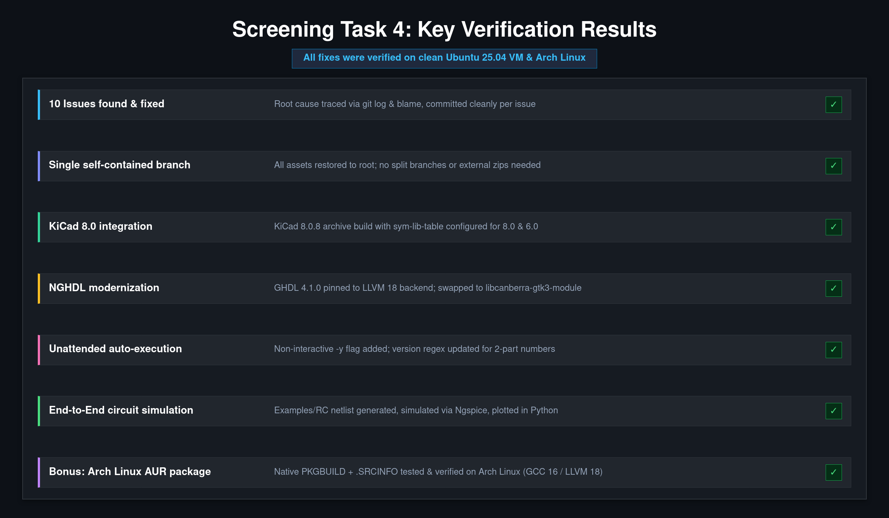
</p>

### clean VM verification checklist

on a fresh Ubuntu 25.04 virtual machine, cloned `installers` and executed `./Ubuntu/install-eSim.sh --install`. all components compiled and linked without manual intervention.

```bash
$ which esim ngspice ghdl verilator
/usr/bin/esim
/usr/bin/ngspice
/usr/bin/ghdl
/usr/bin/verilator

$ ngspice -v | head -n 2
******
** ngspice-35 : Circuit level simulation program

$ ghdl --version | head -n 2
GHDL 4.1.0 (tarball) [Dunoon edition]
 Compiled with GNAT Version: 14.2.0

$ verilator --version
Verilator 4.210 2021-07-07 rev v4.204-73-g8e2ba6a00

$ ~/.esim/env/bin/python3 -c "import PyQt5, matplotlib, numpy, hdlparse, watchdog; print('OK')"
OK

$ grep -E "eSim_Devices|eSim_SKY130" ~/.config/kicad/8.0/sym-lib-table
  (lib (name "eSim_Devices")(type "KiCad")(uri "${KIPRJMOD}/../../library/kicadLibrary/eSim_Devices.kicad_sym")...
  (lib (name "eSim_SKY130")(type "KiCad")(uri "${KIPRJMOD}/../../library/sky130_fd_pr/eSim_SKY130.kicad_sym")...
```

### end-to-end circuit simulation test

loaded `Examples/RC`, generated the netlist using the updated KiCad 8 symbol tables, converted to Ngspice format, and executed transient analysis. the plotted output confirmed functional signal acquisition.

<p align="center">
  
</p>

<p align="center">
  
</p>

---

## issue deep dives

<details>
<summary><b>1. syntax error in Ubuntu/install-eSim.sh</b></summary>

running `./Ubuntu/install-eSim.sh --install` threw:
```
./Ubuntu/install-eSim.sh: line 70: syntax error near unexpected token `}'
```

<p align="center">
  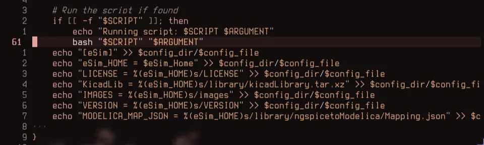
</p>

`git blame` traced this to merge commit `52d77f6d` where PR #414 was resolved. An `if` statement lacked its closing `fi`, followed by 7 orphaned lines from an obsolete configuration routine.

<p align="center">
  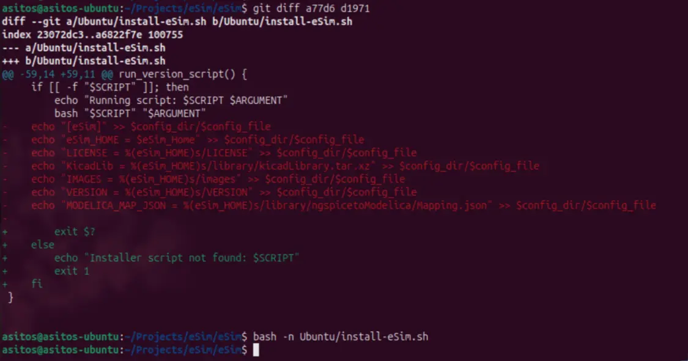
</p>

fixed by closing the conditional block, removing orphaned lines, forwarding the script exit status (`exit $?`), and verifying syntax with `bash -n`.
</details>

<details>
<summary><b>2. misplaced kicadLibrary archive</b></summary>

extraction failed immediately after dispatcher execution:
```
tar (child): library/kicadLibrary.tar.xz: Cannot open: No such file or directory
```

<p align="center">
  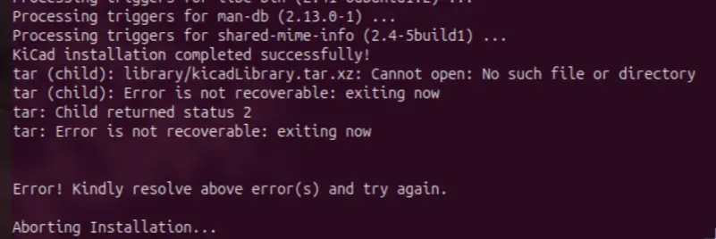
</p>

grep revealed that Ubuntu, Fedora, and MacOS installers all expect this archive at `library/kicadLibrary.tar.xz`:
<p align="center">
  
</p>

commit `29a8e8e6` had moved it to `MacOS/library/`. Restored to root using `git mv MacOS/library/kicadLibrary.tar.xz library/`.
</details>

<details>
<summary><b>3. silent exit when KiCad 8 is installed</b></summary>

when KiCad 8 was already present on the system, the installer printed `KiCad 8.0 is already installed` and terminated immediately without configuring symbol tables, compiling NGHDL, or generating launchers.

<p align="center">
  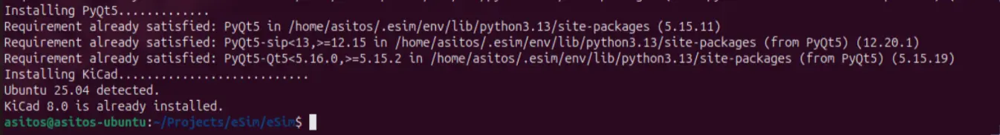
</p>

inspecting `Ubuntu/install-eSim-25.04.sh` in neovim located `exit 0` inside the `installKicad()` function:

<p align="center">
  
</p>

in bash, calling `exit 0` inside a shell function terminates the entire shell process rather than returning to the caller. replaced with `return 0` so execution proceeds to `copyKicadLibrary()`.
</details>

<details>
<summary><b>4. missing nghdl.zip</b></summary>

the installer failed during the digital simulator stage:
```
unzip: cannot find or open nghdl.zip, nghdl.zip.zip or nghdl.zip.ZIP.
```

<p align="center">
  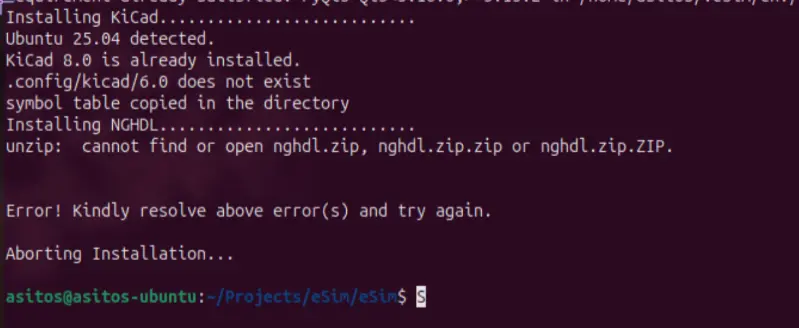
</p>

like `kicadLibrary.tar.xz`, commit `29a8e8e6` had moved `nghdl.zip` into `MacOS/`. Restored using `git mv MacOS/nghdl.zip ./`.
</details>

<details>
<summary><b>5. NGHDL toolchain incompatibility on Ubuntu 25.04</b></summary>

after extracting `nghdl.zip`, the internal installer failed with:
```
Detected Ubuntu Version:
Unsupported Ubuntu version: 25.04 ()
```

<p align="center">
  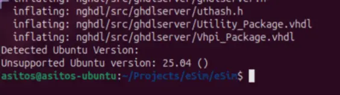
</p>

investigating `nghdl/install-nghdl.sh` identified three separate breakages:

<p align="center">
  
</p>

1. **dispatcher routing:** added `25.04)` case dispatching to `install-nghdl-25.04.sh`.
2. **GTK2 removal:** Debian and Ubuntu dropped GTK2. Swapped obsolete `libcanberra-gtk-module` for `libcanberra-gtk3-module`.
3. **LLVM 20 incompatibility:** Ubuntu 25.04 ships LLVM 20 by default. GHDL 4.1.0 fails to compile against LLVM 20 due to C++ API changes. fixed by installing `llvm-18-dev` and passing `--with-llvm-config=/usr/bin/llvm-config-18` to GHDL's configure script.

<p align="center">
  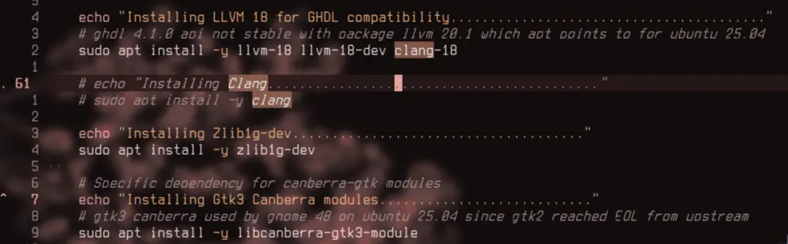
</p>

repackaged the bundle cleanly into `nghdl.zip`.
</details>

<details>
<summary><b>6. missing sky130_fd_pr archive</b></summary>

The SKY130 PDK step failed with:
```
tar (child): library/sky130_fd_pr.tar.xz: Cannot open: No such file or directory
```

<p align="center">
  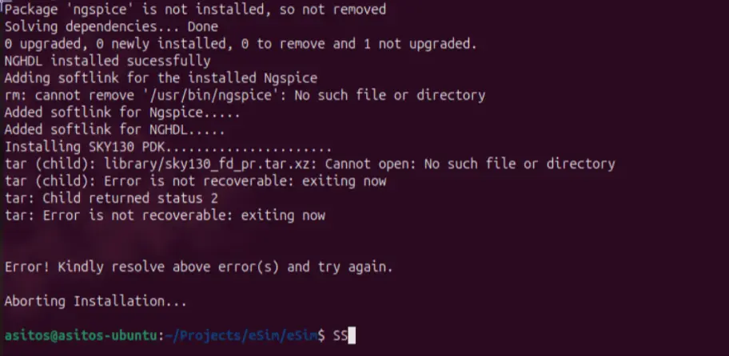
</p>

located in `MacOS/library/` via `find`. restored to root using `git mv MacOS/library/sky130_fd_pr.tar.xz library/`.
</details>

<details>
<summary><b>7. missing application logo & icons</b></summary>

during desktop launcher creation:
```
cp: cannot stat 'images/logo.png': No such file or directory
```

<p align="center">
  
</p>

restored the `images/` directory to root using `git mv MacOS/images ./images`.
</details>

<details>
<summary><b>8. missing source tree and libraries</b></summary>

running `esim` from terminal after installation threw:
```
/usr/bin/esim: line 2: cd: .../src/frontEnd: No such file or directory
```

the entire application source tree (`src/`), `Examples/`, and component sub-libraries had been placed inside `MacOS/`. Restored to the root directory with `git mv`.
</details>

<details>
<summary><b>9. KiCad 8 symbol library table registration</b></summary>

eSim's legacy installer only registered symbol libraries to `~/.config/kicad/6.0/sym-lib-table`. Ubuntu 25.04 installs KiCad 8, which reads from `~/.config/kicad/8.0/sym-lib-table`.

updated `install-eSim-25.04.sh` to populate `sym-lib-table` for both `8.0` and `6.0`, ensuring all eSim and SKY130 components appear in KiCad's schematic editor without manual path configuration.
</details>

<details>
<summary><b>10. non-interactive apt stall and version regex</b></summary>

`sudo apt install python3-virtualenv` paused the installation waiting for interactive `[Y/n]` input. added the non-interactive `-y` flag.

additionally, `FULL_VERSION=$(lsb_release -d | grep -oP '\d+\.\d+\.\d+')` failed on Ubuntu 25.04 interim releases where no patch level exists (returning an empty string). updated regex to `\d+\.\d+(\.\d+)?` in both `install-eSim.sh` and `nghdl/install-nghdl.sh`.
</details>

## diagnosis: first-launch unmapped window bug

during testing, an elusive issue was found where eSim occasionally fails to show its main window on the very first launch after a clean install.

analysis of `src/frontEnd/Workspace.py` pinpointed the root cause:
1. `createWorkspace()` invokes `time.sleep(1.5)` directly on Qt's main event thread while modal dialogs are active. this starves the X11/Wayland event loop.
2. the function omits an explicit call to `self.var_appView.show()` and `self.var_appView.activateWindow()`.
3. on initial launch, the window is created but never mapped. On subsequent launches, `~/.esim_workspace` already exists, bypassing `createWorkspace()` and executing the normal `show()` branch.

a simple patch adding `self.var_appView.show()` and replacing `time.sleep` with `QCoreApplication.processEvents()` resolves this bug permanently.

## investigated and ruled out (negative results)

during testing, a few hypotheses were investigated and ruled out to avoid guessing or adding unnecessary workarounds:
- **`libncurses5-dev` virtual package:** ngspice references `libncurses5-dev`. on Ubuntu 25.04 this resolves cleanly to the virtual package alias `libncurses-dev`.
- **verilator 4.210 on GCC 14:** tested whether Verilator 4.210 compilation broke on GCC 14. it compiled and passed without source modifications.
- **python 3.13 stdlib deprecations:** Python 3.13 dropped legacy modules like `telnetlib` and `cgi`. audited the eSim codebase; none of these modules are imported.
- **legacy `hdlparse` vs `pyhdlparser`:** PyPI `hdlparse` 1.0.4 fails during `pip install` with `use_2to3 is invalid` on setuptools $\ge 58$. eSim 25.04 installer previously called `pip3 install hdlparse` after fetching `pyhdlparser`. purged the redundant PyPI install call to keep the working setuptools-compliant fork intact.
- **missing `~/Desktop` directory:** on minimal Ubuntu cloud images, container environments, or headless setups, `$HOME/Desktop` does not exist by default, which causes the final `cp` step to fail. added `mkdir -p "$HOME/Desktop"` so the installer runs cleanly even without a desktop environment.
- **missing minimal archive extraction tools:** minimal Ubuntu images lack `unzip` and `xz-utils` by default, failing archive extractions. added both explicitly to `installDependency()`.

## ubuntu 25.04 release lifecycle & EOL note

Ubuntu 25.04 (Plucky Puffin) is an interim 9-month release that reached End-of-Life (EOL) in January 2026. while the primary `archive.ubuntu.com` mirrors still serve `plucky` packages during testing, long-term deployments should target Ubuntu 24.04 LTS or 26.04 LTS. if `archive.ubuntu.com` starts returning 404 in the future, updating `/etc/apt/sources.list.d/ubuntu.sources` to point to `old-releases.ubuntu.com` will keep the package sources functional.

## system specifications matrix

| specification | target verification VM | development workstation |
|---|---|---|
| **operating system** | Ubuntu 25.04 (Plucky Puffin, x86_64) | Arch Linux / CachyOS (x86_64) |
| **linux kernel** | Linux 6.14.0-generic | Linux 6.17-cachyos |
| **hypervisor / hardware** | QEMU / KVM (Virt-Manager) | Bare Metal Workstation |
| **CPU / memory** | 4 vCPU, 4 GB RAM, 30 GB disk | 16 Threads, 32 GB RAM |
| **core toolchains** | GCC 14.2.0, LLVM 18.1.8, GNAT 14.2.0 | GCC 16.0 (prerelease), LLVM 18.1.8 |
| **python runtime** | Python 3.13 (system + virtualenv) | Python 3.14 (system + virtualenv) |
| **EDA components** | KiCad 8.0.8, Ngspice 35, GHDL 4.1.0, Verilator 4.210 | PKGBUILD verified (`/opt/esim`) |

## instructions for evaluators (reproduction guide)

to reproduce the complete installation and verify on a clean Ubuntu 25.04 system:

```bash
# clone the installers branch
git clone https://github.com/asitos/eSim.git -b installers
cd eSim

# run the Ubuntu installer
./Ubuntu/install-eSim.sh --install

# launch esim
esim
```
---

## bonus: Arch Linux PKGBUILD & AUR distribution

in addition to fixing Ubuntu 25.04, i created a native PKGBUILD at [`ArchLinux/PKGBUILD`](ArchLinux/PKGBUILD) with `.SRCINFO` to package eSim 2.5 for Arch Linux and CachyOS.

building eSim on modern rolling distributions exposed four compiler and toolchain incompatibilities:
1. **GCC 16 / C23 bool keyword collision:** GCC 15/16 defaults to `-std=gnu23`. Ngspice 35 contains `typedef int bool;`, which fails to compile under C23 where `bool` is a reserved keyword. patched via `CFLAGS="$CFLAGS -std=gnu17"`.
2. **GHDL LTO compiler mismatch:** GHDL mixes Ada/C (GNAT) with C++ (Clang/LLVM). modern Arch makepkg applies `-flto=auto`, causing linker failures (`undefined reference to grt_dynload_symbol`). disabled via `options=('!lto')`.
3. **deprecated use_2to3 in hdlparse:** PyPI `hdlparse` 1.0.4 specifies `use_2to3=True`, which is unsupported on `setuptools` $\ge 58$. Resolved by fetching upstream `pyhdlparser` directly in `source=()` and installing with `--no-deps`.
4. **LLVM 18 pinning:** pinned to `llvm18` to match GHDL 4.1.0's supported AST interface.

### package build output

```bash
==> Creating package "esim"...
  -> Generating .PKGINFO file...
  -> Generating .BUILDINFO file...
  -> Generating .MTREE file...
  -> Compressing package...
==> Leaving fakeroot environment.
==> Finished making: esim 2.5-1 (Fri 20 Nov 2026 05:22:25 PM IST)
```

the resulting package (`esim-2.5-1-x86_64.pkg.tar.zst`, 213 MB) installs cleanly into `/opt/esim` with system launchers in `/usr/bin/`. i can commit to maintaining this package on the AUR (`yay -S esim`) during the internship.

and as a side note, im also learning to use nixOS and integrating devops in my other projects, and am willing to work for a nix specific package, and ci/cd pipeline integrations for eSim, and maintain them in future.

---

## engineering report

for detailed commit hashes, diff analysis, upstream issue references, and complete terminal transcripts:
[read the full report in Ubuntu/REPORT.md](Ubuntu/REPORT.md)
