# eSim 2.5 on Ubuntu 25.04: report of fixes

Ashutosh Parashar ([@asitos](https://github.com/asitos)) <br>
Screening Task 4, FOSSEE Semester-Long Internship, Autumn 2026

---

<b>test environment:</b> Ubuntu 25.04 (Plucky Puffin) on a VM<br>
<p align="center">
  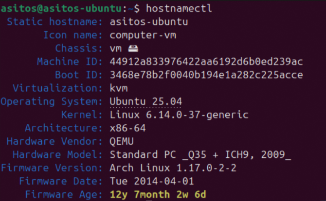
</p>

<b>development environment:</b> Arch Linux<br>

<p align="center">
  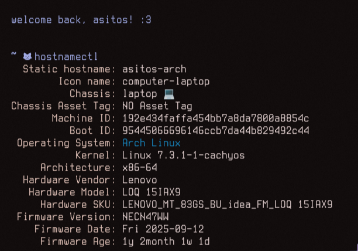
</p>


<b>tools used:</b>
- neovim for editing files
- bash, grep, git to trace errors and bugs
- qemu-virtualbox for test environment
- an LLM coding agent to assist me in verifying & documenting these flaws


## starting point

the `installers` branch has scripts to install eSim on Ubuntu. running `./Ubuntu/install-eSim.sh --install` on 25.04 dies immediately:

```
./Ubuntu/install-eSim.sh: line 70: syntax error near unexpected token `}'
./Ubuntu/install-eSim.sh: line 70: `}'
```

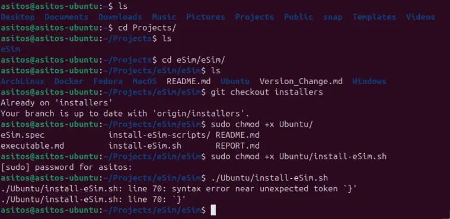

that was the first of many. after fixing it, i found the installer to come across 9 more problems before eSim would actually start.

---

## summary of fixes

| # | problem | fix | commit |
|---|---|---|---|
| 1 | bash syntax error at line 70 | closed dangling `if`, removed orphaned lines | `d19714a1` |
| 2 | `kicadLibrary.tar.xz` not found | `git mv` from `MacOS/library/` to root | `58b7a219` |
| 3 | installer quits silently when KiCad 8 is already present | `exit 0` to `return 0` | `fc2248c5` |
| 4 | `nghdl.zip` not found | `git mv MacOS/nghdl.zip ./` | `d088fc94` |
| 5 | "unsupported Ubuntu version: 25.04" in NGHDL | Added 25.04 routing, pinned LLVM 18, GTK2 to GTK3 | `2dff020a` |
| 6 | `sky130_fd_pr.tar.xz` not found | `git mv` from `MacOS/library/` to root | `c9a4fedc` |
| 7 | `images/logo.png` not found | `git mv MacOS/images ./images` | `280df64b` |
| 8 | `esim` command fails, `src/frontEnd` missing | Moved `src/`, `Examples/`, sub-libraries from `MacOS/` to root | `d9d3a534` |
| 9 | KiCad 8 ignores eSim symbol libraries | Write sym-lib-table to `~/.config/kicad/8.0/` not just `6.0/` | `d9d3a534` |
| 10 | `apt` prompt stalls installer; empty version string | Added `-y` flag; fixed version regex for 2-part versions | Staged |

## walking through it

### 1. syntax error in the dispatcher

opened `install-eSim.sh` in neovim. the `run_version_script()` function had an `if` without a closing `fi`, plus 7 orphaned lines from an old `createConfigFile` routine that got tangled during a merge:


`git blame` traced it to merge commit `52d77f6d` where PR #414 got merged into `installers`. the conflict resolution left the function broken. closed the block, cleaned the orphans, ran `bash -n` to check, committed.


---

### 2. files in the wrong folder

after the syntax fix, the installer got further but failed on missing archives:

```
tar (child): library/kicadLibrary.tar.xz: Cannot open: No such file or directory
```


ran `grep -Pnr "library/kicadLibrary.tar.xz" ./` to check who references this path. Ubuntu, Fedora and MacOS installer scripts expect it at the repo root:

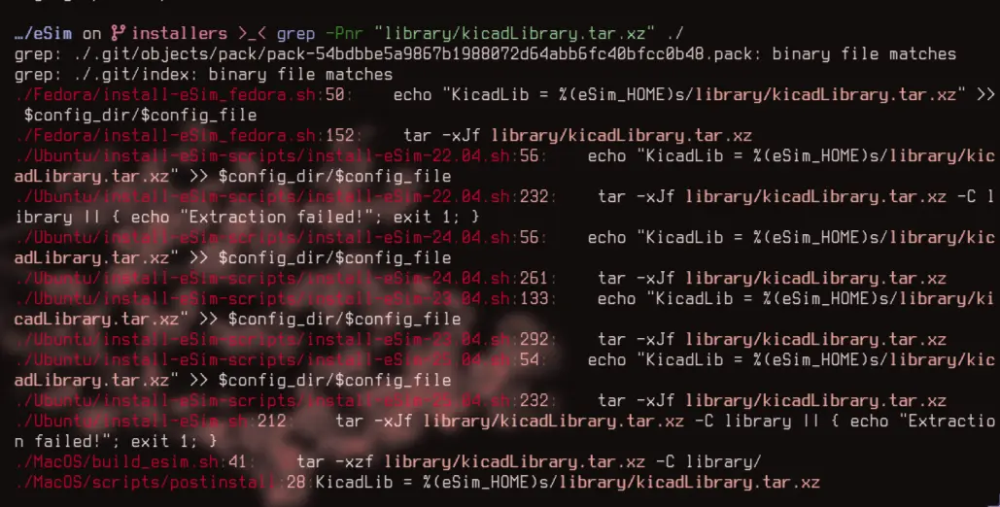

the function that extracts the library:

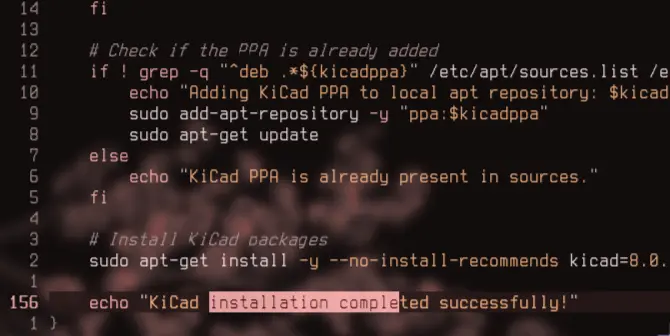

so where was the file? `git log --diff-filter=A --summary -- MacOS/library/kicadLibrary.tar.xz` pointed to commit `29a8e8e6`: "Added macos support installing folder". that commit put shared release assets (`kicadLibrary.tar.xz`, `nghdl.zip`, `sky130_fd_pr.tar.xz`, `images/`, `src/`, `Examples/`) into `MacOS/` instead of the repo root. one commit, broke every other platform.

fix: `git mv` to put things back. did this across multiple commits as each failure came up.

same thing happened with `sky130_fd_pr.tar.xz`:


found it in `MacOS/library/` with `find`:

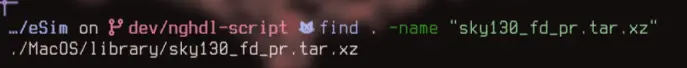

---

### 3. silent exit trap

re-ran the installer after KiCad was already present. it printed "KiCad 8.0 is already installed" and just stopped. No error, exit code 0. NGHDL, SKY130, desktop shortcuts: none of it ran.


Found it at line 135: `exit 0` inside `installKicad()`.

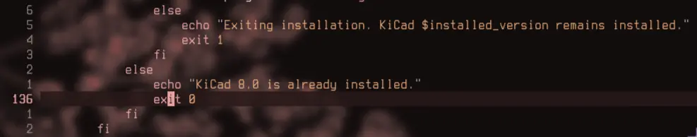

`exit 0` inside a bash function doesn't return from the function. It kills the whole process. changed to `return 0` so that control is transferred to the next function (`copyKicadLibrary()`).

---

### 4. nghdl has no idea about 25.04

after extracting `nghdl.zip`, the internal installer rejected the OS:

```
detected Ubuntu Version:
unsupported Ubuntu version: 25.04 ()
```


looked at the case block in neovim. no entry for 25.04:

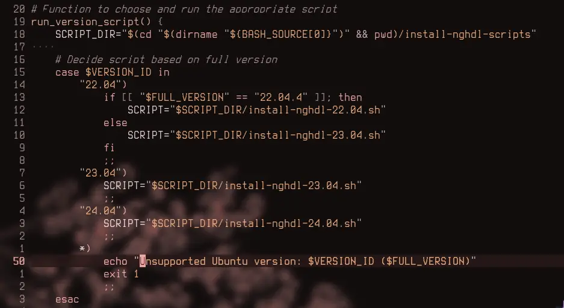

three things to fix here:

**a) add 25.04 switch case.** copied `install-nghdl-24.04.sh` as the base, added the case:

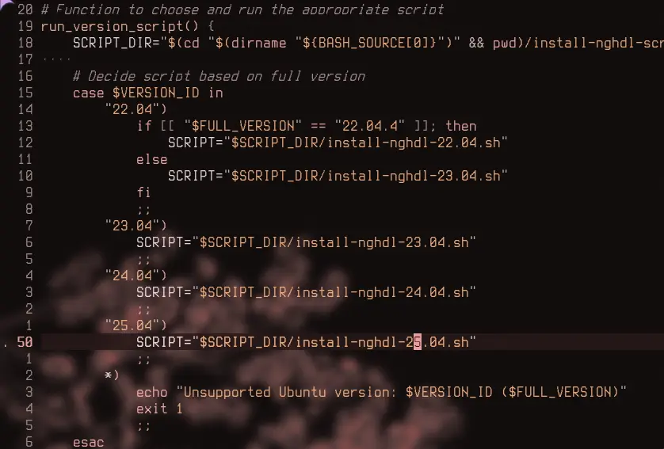

**b) gtk2 is gone on 25.04.** `libcanberra-gtk-module` (gtk2) has no installation candidate. Debian and Ubuntu dropped it. swapped to `libcanberra-gtk3-module`.

**c) ghdl 4.1.0 won't build against llvm 20.** Ubuntu 25.04 ships llvm 20 by default. ghdl talks directly to llvm's c++ APIs, and llvm breaks those between major versions ([ghdl issue #2711](https://github.com/ghdl/ghdl/issues/2711)). Fix: install the co-installable `llvm-18-dev` and point ghdl at it with `--with-llvm-config=/usr/bin/llvm-config-18`.

the edited `install-nghdl-25.04.sh`: llvm 18 pinned, old generic `clang` line commented out, gtk3 replacing gtk2:


rebundled into `nghdl.zip` using zip by:

```bash
# remove older .zip
rm -f nghdl.zip

zip -r nghdl.zip nghdl/

# remove previously extracted folder
rm -rf nghdl/
```

---

### 5. missing logo, missing source, missing everything

near the end of the install:

```
cp: cannot stat 'images/logo.png': No such file or directory
Error! Kindly resolve above error(s) and try again.
Aborting Installation...
```

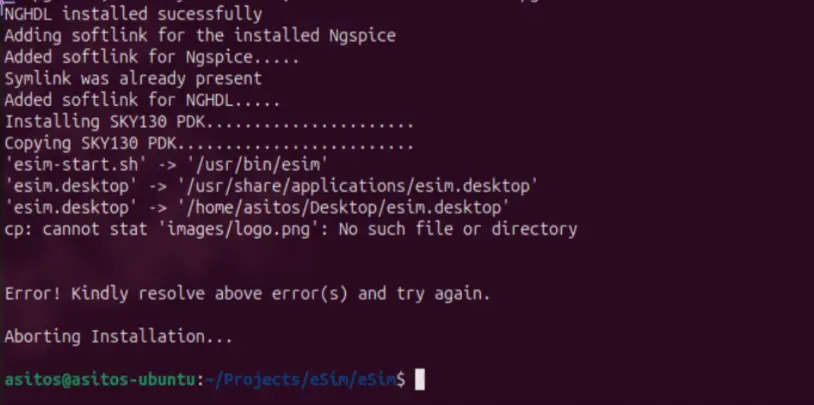

grepped for it. every script references `images/logo.png` relative to root:

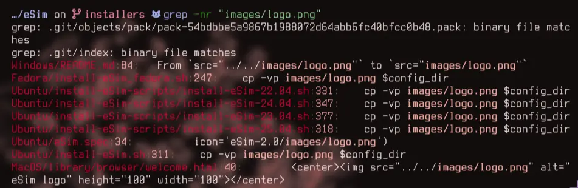

the function that copies it:

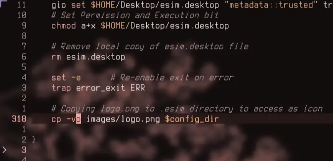

same problem caused by commit `29a8e8e6` relocating files in MacOS directory.
fixed by a simple relocation: `git mv MacOS/images ./images`.

then the last one, after installation completed, running `esim` from terminal:

```
/usr/bin/esim: line 2: cd: .../src/frontEnd: No such file or directory
```

the whole source tree (`src/`, `Examples/`, component libraries) was still inside `MacOS/`. moved everything to root with `git mv`. after this, `MacOS/` only holds what it should: macOS build scripts.

## verification

clean ubuntu 25.04 VM, fresh `git clone -b installers`, ran the installer, launched eSim, simulated the RC example.

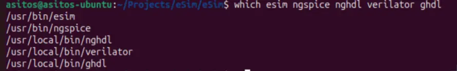

```bash
$ ngspice -v | head -n 2
******
** ngspice-35 : Circuit level simulation program

$ ghdl --version | head -n 2
GHDL 4.1.0 (tarball) [Dunoon edition]
 Compiled with GNAT Version: 14.2.0

$ verilator --version
Verilator 4.210 2021-07-07 rev v4.204-73-g8e2ba6a00

$ ~/.esim/env/bin/python3 -c "import PyQt5, matplotlib, numpy, hdlparse, watchdog; print('OK')"
OK

$ grep -E "eSim_Devices|eSim_SKY130" ~/.config/kicad/8.0/sym-lib-table
  (lib (name "eSim_Devices")...
  (lib (name "eSim_SKY130")...
```

opened `Examples/RC`, converted KiCad schematic to Ngspice netlist, ran transient simulation, got the waveform:

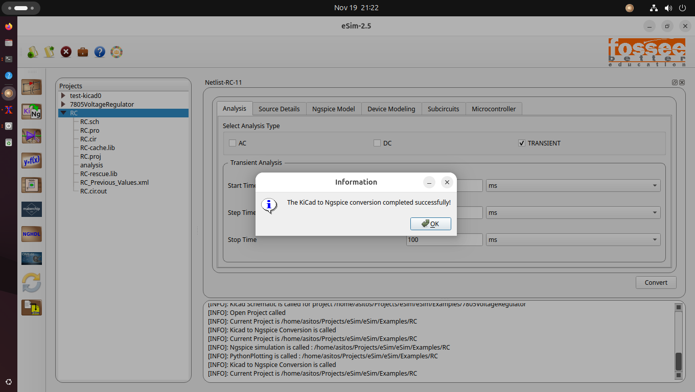
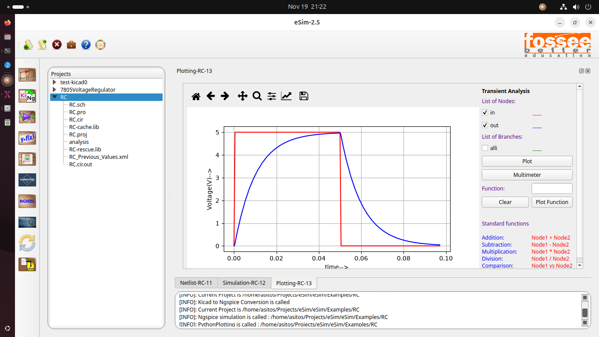

---

## bonus: Arch Linux PKGBUILD

the repo already has `ArchLinux/install-eSim.sh` and `ArchLinux/install-eSim-scripts/install-nghdl-arch.sh` for Arch, but there's no proper PKGBUILD for distributing eSim through the AUR.

i wrote one at [`ArchLinux/PKGBUILD`](ArchLinux/PKGBUILD). it packages eSim 2.5 for Arch/CachyOS, pulls GHDL and Verilator from the bundled tarballs, pins LLVM 18 for GHDL compatibility, and installs everything into `/opt/esim` with a launcher script.

if given the opportunity during the internship, i would like to maintain this as an AUR package so Arch users can install eSim with a single `yay -S esim` instead of running shell scripts.

im also currently learning to use nix alongside, could help with a nix flake for eSim later in the future.

## more things noticed

- on the first launch after a fresh install, the eSim window sometimes stays unmapped. traced it to `src/frontEnd/Workspace.py`: `createWorkspace()` does `time.sleep(1.5)` on Qt's main thread while modal modality is active, then never calls `show()` on the main window. Later launches bypass this path and work fine.
- the installer prints `rm: cannot remove '/usr/bin/ngspice'` on fresh systems, harmless, `rm -f` would fix it.

## full report

detailed write-up with git forensic traces, upstream citations, and the complete debugging timeline: [Ubuntu/REPORT.md](Ubuntu/REPORT.md)

---

it was fun to work on this, i haven't worked with debian based distros in a while, thank you for your time!!
